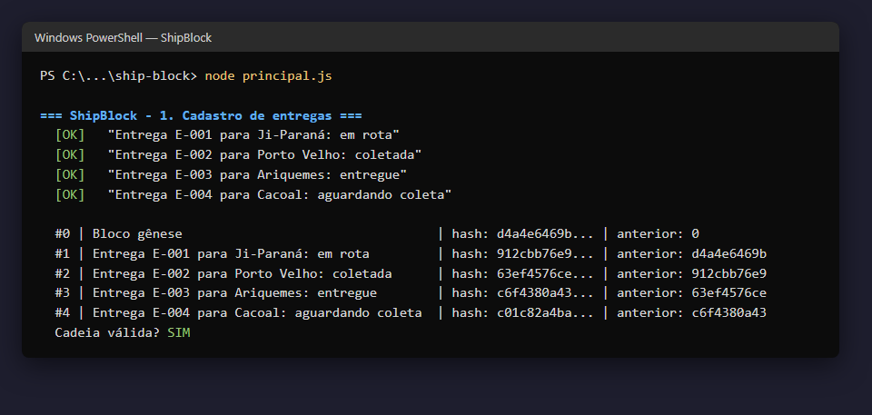
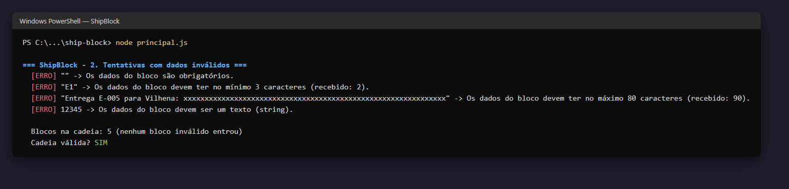
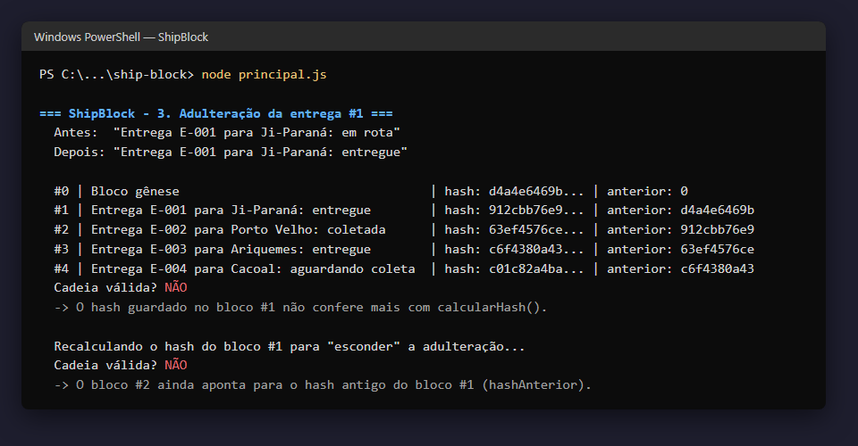

# ShipBlock

Registro de entregas à prova de adulteração, construído como uma blockchain simples em JavaScript (Node.js).
Atividade **A4 – Blocos reutilizáveis em JavaScript** da disciplina Tópicos Especiais em Tecnologia II (IFRO).

O projeto aplica as três ideias vistas em sala:

1. **Hash que identifica cada bloco**: SHA-256 de `indice + dados + hashAnterior`.
2. **Encadeamento pelo hash anterior**: cada bloco guarda o hash do bloco que vem antes.
3. **Validação que percorre a cadeia**: `ehValida()` recalcula os hashes e confere os elos.

## Estrutura

| Arquivo         | Responsabilidade                                                                              |
| --------------- | --------------------------------------------------------------------------------------------- |
| `bloco.js`      | Classe `Bloco`: valida os dados (mensagens em português) e calcula o próprio hash.            |
| `blockchain.js` | Classe `Blockchain`: começa no bloco gênese, `adicionar(dados)` e `ehValida()`.               |
| `principal.js`  | `imprimirCadeia(cadeia)` e o fluxo de demonstração (cadastro, dados inválidos, adulteração).  |
| `prints/`       | Capturas da execução do programa.                                                             |

## Regras do bloco

- `indice`: número inteiro ≥ 0 (posição na cadeia).
- `dados`: texto obrigatório, de 3 a 80 caracteres.
- `hashAnterior`: hash do bloco anterior (`'0'` no gênese).
- `hash`: calculado pelo próprio bloco em `calcularHash()`, nunca recebido de fora.

Dados inválidos lançam `Error` com mensagem em português, e o bloco não entra na cadeia.

## Como executar

Requer Node.js 18 ou superior. O projeto não tem dependências externas (usa o módulo nativo `crypto`).

```bash
node principal.js
# ou
npm start
```

## Prints

### 1. Cadastro de entregas e validação


### 2. Tentativas com dados inválidos


### 3. Adulteração de uma entrega antiga


A execução completa está em [`prints/00-execucao-completa.png`](prints/00-execucao-completa.png).
